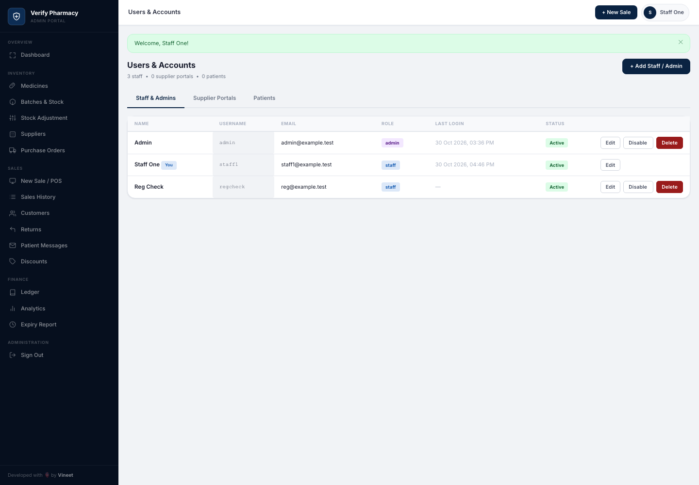
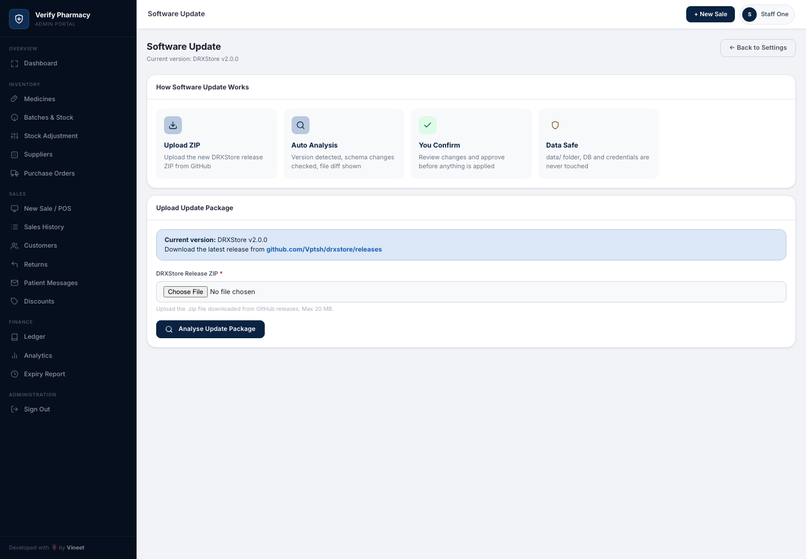
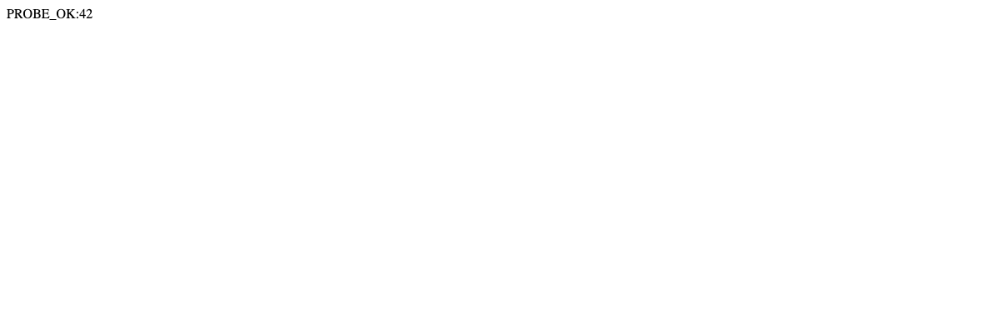

# DRXStore 2.0.0 — broken authorization to remote code execution

A staff-level account in DRXStore 2.0.0 could reach every admin-only page, promote itself to
administrator, and upload PHP that executes on the server. Fixed in 3.0.0.

| | |
|---|---|
| **Product** | DRXStore — pharmacy management system (PHP, self-hosted) |
| **Vendor** | Vineet Pratap Singh — [github.com/psvineet](https://github.com/psvineet) |
| **Affected** | 2.0.0 (verified on 2.0.0, commit `4d0be4e`) |
| **Fixed** | 3.0.0 — [release](https://github.com/psvineet/drxstore/releases/tag/v3.0.0) |
| **Severity** | 8.8 High — `CVSS:3.1/AV:N/AC:L/PR:L/UI:N/S:U/C:H/I:H/A:H` |
| **CWE** | CWE-863 Incorrect Authorization · CWE-434 Unrestricted Upload of File with Dangerous Type |
| **CVE** | pending — GitHub assigns it after publication; this page is updated when it lands |
| **Advisory** | [GHSA-7xhx-j29g-xgx4](https://github.com/psvineet/drxstore/security/advisories/GHSA-7xhx-j29g-xgx4) — published 2026-10-30 |
| **Reporter** | Anil Kumar Voleti — [LinkedIn](https://www.linkedin.com/in/voleti-anil/) · [GitHub](https://github.com/AnilKumarVoleti) |

## Summary

DRXStore ships two roles, `admin` and `staff`, and an allow-list (`STAFF_ALLOWED_PAGES`) that
delimits what a staff account may do. The allow-list is enforced inside `requireStaff()`. The guard
that protects the *admin* pages is a different function, `requireAdmin()`, and it only checks that
some admin session exists:

```php
// helpers/functions.php (2.0.0)
function requireAdmin(): void {
    startSession();
    if (empty($_SESSION['admin_id'])) { header('Location: index.php?p=login'); exit; }
}
```

`$_SESSION['admin_role']` is never consulted. A staff session satisfies the check, so the pages that
actually needed protecting were open to the lowest-privileged account the application creates.

Two capabilities on those pages turn that into something worse:

- `users.php` writes the submitted `role` field straight into the user record, so a staff user can
  make themselves an admin.
- `software_update.php` extracted a user-supplied ZIP into the application root, protecting only
  `data/` — no file-type check, no signature. A PHP file in the archive is then served and executed.

The authorization flaw is what lets a staff account reach the updater; the updater is what turns that
reach into code execution.

## The chain

### 1. A staff session reaches admin-only pages

Signed in as `staff1` (role `staff`), requesting `?p=users` returns the full user-management UI
rather than redirecting to login. Same for `?p=settings` and `?p=sw_update`.



`Users & Accounts` with an "Add Staff / Admin" button, Edit/Disable/Delete on every row, and a role
column — from an account whose own role badge reads `staff`.



The updater page, including its ZIP upload form, from the same session.

### 2. Self-escalation to admin

`users.php` takes the role from the request body (`$role = post('role','staff')`) and writes it
without any authorization check of its own:

```http
POST /index.php?p=users HTTP/1.1
Content-Type: application/x-www-form-urlencoded

csrf_token=…&action=edit_staff&id=2&name=Staff+One&username=staff1
 &email=staff1%40example.test&password=&role=admin
```

The stored record flips:

```
before:  [("admin","admin"), ("staff1","staff")]
after:   [("admin","admin"), ("staff1","admin")]
```

### 3. Code execution through the updater

The updater locates "the release root" inside an uploaded archive by looking for a folder containing
both `index.php` and `config/app.php`, then copies every file under it into the application root,
skipping only `data/`:

```php
if (strpos($rel,'data/') === 0) { $skipped++; continue; }
$dest = ROOT.'/'.$rel;
@copy($src->getPathname(), $dest);      // no extension check, no allow-list, no signature
```

So a package containing the payload next to copies of those two files is accepted, and the payload
is written into the web root. Requesting it executes it:



`6*7` computed by the server — the file is interpreted, not merely stored. The same run returned the
host name, the OS user and the OS version, all values only the server could supply.

## Impact

An attacker holding a staff account — the role a pharmacy hands to a counter clerk — obtains full
administrative control of the installation and then arbitrary code execution as the web-server user.

On the instance used for this research, that meant access to customer records, prescription uploads,
sales and stock data, the SMTP password stored in `settings.json`, and a shell on the host.

## Reproduction

The three scripts in [`poc/`](poc/) drive the whole thing against a local copy:

```bash
# vulnerable instance (2.0.0) on :8903
php -S 127.0.0.1:8903 -t /path/to/drxstore-2.0.0

python3 poc/poc.py        http://127.0.0.1:8903 /path/to/drxstore-2.0.0   # marker: proves code ran
python3 poc/poc_impact.py http://127.0.0.1:8903 /path/to/drxstore-2.0.0   # command exec + data read
```

Both bootstrap the instance themselves (setup wizard, admin, staff account) and exit non-zero if any
step does not behave as claimed. The impact script deletes the dropped file at the end and verifies
it is gone.

The raw upload request captured from the wire is in
[`evidence/upload-request.http`](evidence/upload-request.http).

## Verifying the fix

A proof of concept that stops working because it broke looks identical to a fixed application. So
`poc/verify_patch.py` takes the expected outcome as an argument and asserts the *observed* one:

```bash
python3 poc/verify_patch.py http://127.0.0.1:8903 /path/to/2.0.0 --expect vulnerable
python3 poc/verify_patch.py http://127.0.0.1:8902 /path/to/3.0.0 --expect fixed
```

| # | Claim | 2.0.0 | 3.0.0 |
|---|---|---|---|
| 1 | Admin pages reachable from a staff session | reached (200) | blocked (302 → login) |
| 2 | Staff promotes itself to admin | role changed | unchanged |
| 3 | PHP written to web root and executed | executed | no upload path, nothing written |

Both runs are archived verbatim:
[2.0.0](evidence/verify-v2-vulnerable.txt) · [3.0.0](evidence/verify-v3-fixed.txt).

The 2.0.0 run is the control — it proves the probes still work, which is what makes the 3.0.0 result
mean something. The script also checks that an admin session still receives 200 on those pages and
can still create a user, so a fix that simply locked administrators out would fail verification.

### What the fix changed

- `requireAdmin()` now requires `($_SESSION['admin_role'] ?? '') === 'admin'`.
- The updater no longer accepts user-uploaded archives at all — it fetches releases from GitHub
  itself, pins the allowed hosts, and refuses new PHP files during extraction.

### Scope

This verification covered the three reported issues, the documented self-role-change limitation, and
admin regression, on a fresh JSON-storage install of each version. It is **not** an audit of the rest
of the 3.0.0 changeset and should not be read as a clean bill of health for that release.

## Timeline

| Date | Event |
|---|---|
| 2026-10-28 | Discovered and reproduced on 2.0.0; reported privately to the maintainer |
| 2026-10-30 | 3.0.0 published; patch verified against it and against 2.0.0 as a control |
| 2026-10-30 | Security advisory [GHSA-7xhx-j29g-xgx4](https://github.com/psvineet/drxstore/security/advisories/GHSA-7xhx-j29g-xgx4) published |
| pending | CVE ID assigned by GitHub (CNA) and added here |

Disclosed privately before any public detail, and only ever tested against local copies.

## Credit

Reported by **Anil Kumar Voleti** — [LinkedIn](https://www.linkedin.com/in/voleti-anil/) ·
[GitHub](https://github.com/AnilKumarVoleti). Fixed promptly by the maintainer, Vineet Pratap Singh.
